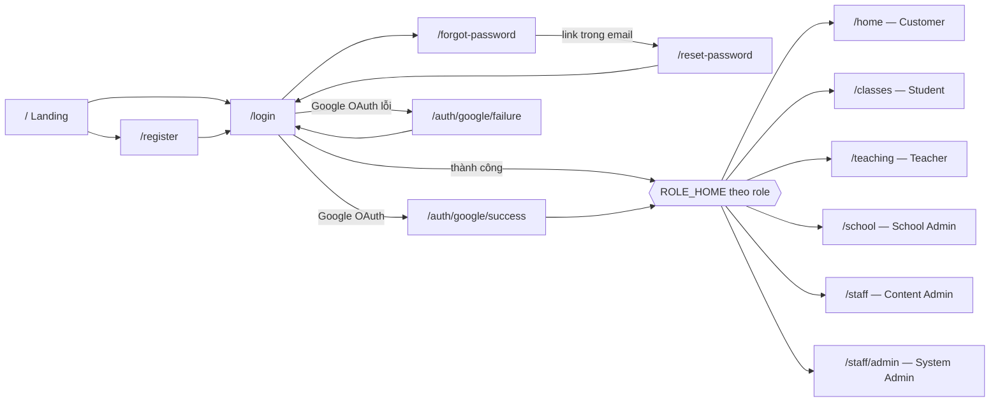
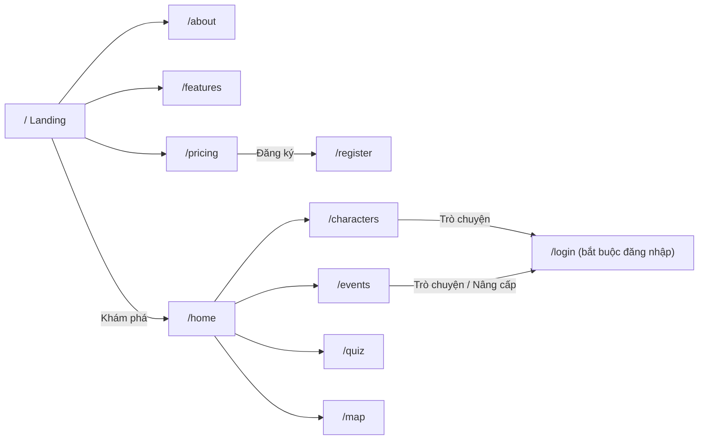
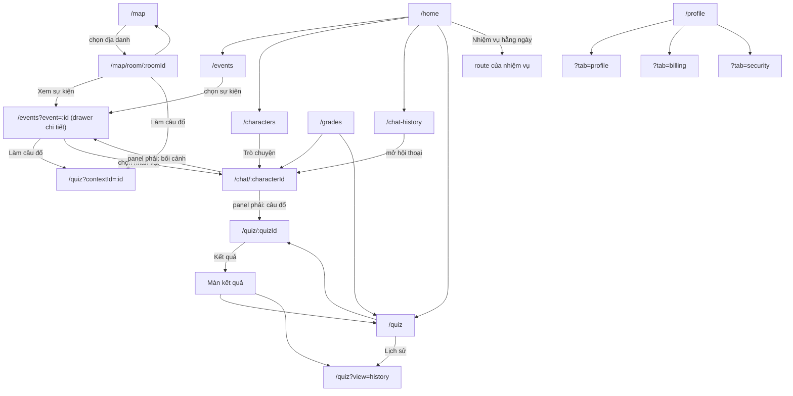
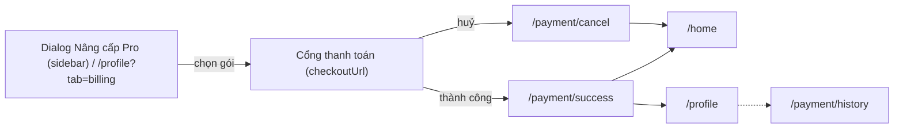
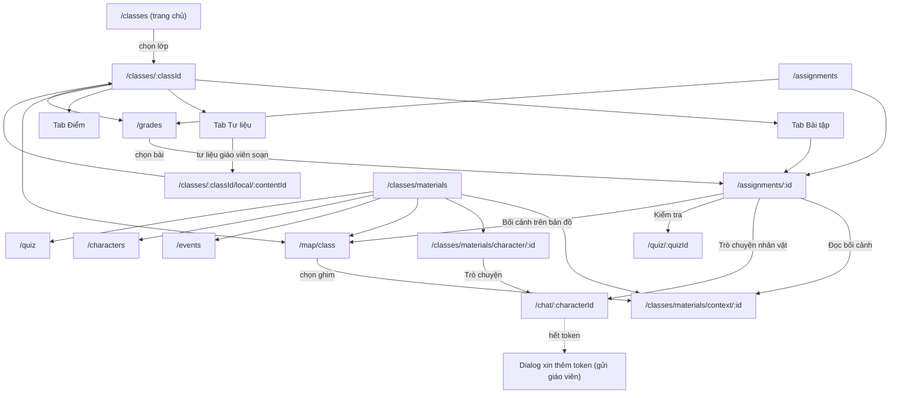
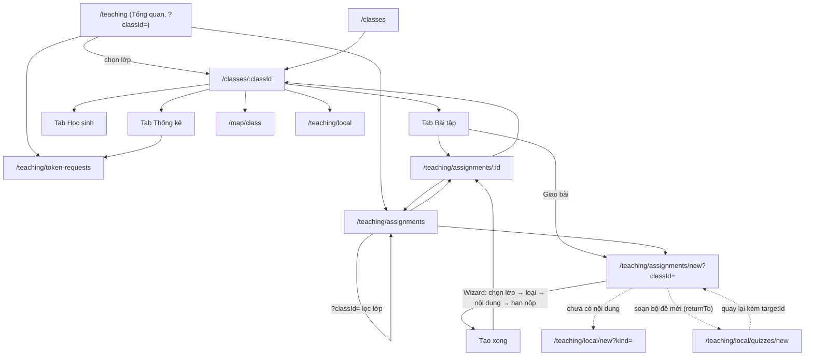
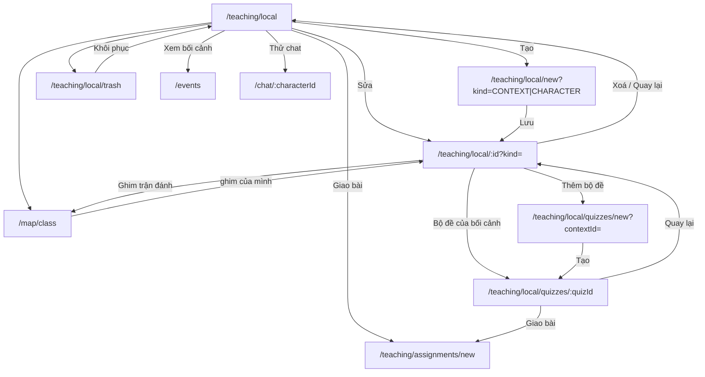
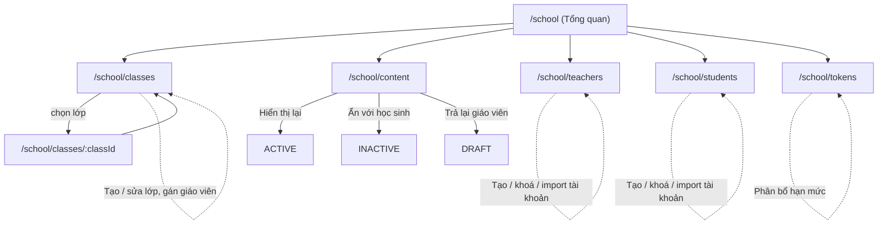
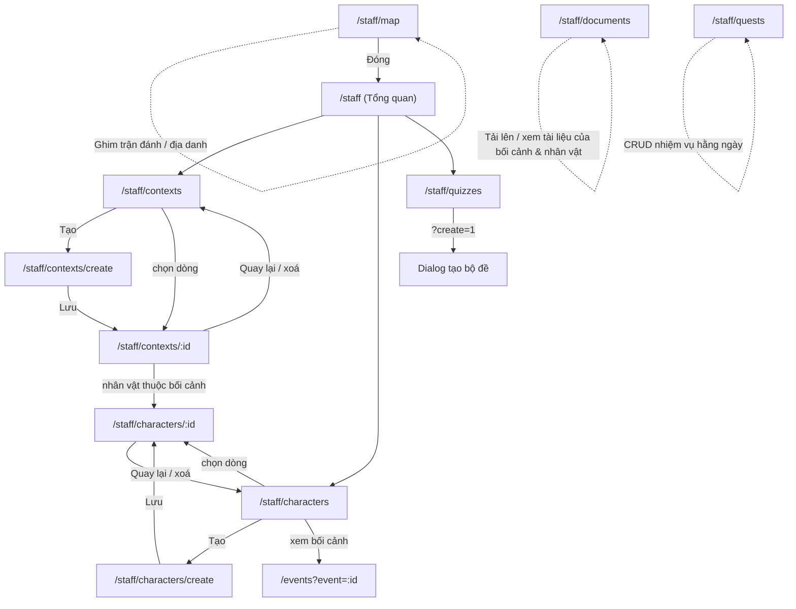
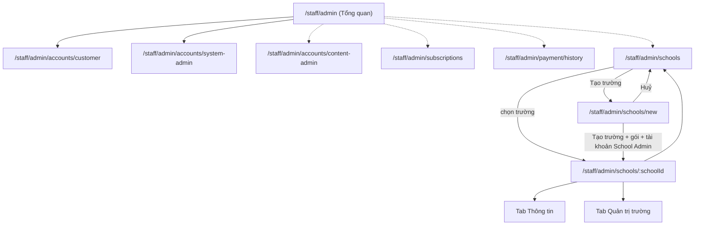

# Screen Flow theo Role — HistoryTalk FE

Tài liệu mô tả luồng màn hình của từng role, dựng từ code hiện tại:

- Phân quyền route: [src/middlewares/auth.middleware.ts](../src/middlewares/auth.middleware.ts), [src/components/context/customer-route-guard.tsx](../src/components/context/customer-route-guard.tsx)
- Trang chủ mỗi role: `ROLE_HOME` trong [src/constants/roles.ts](../src/constants/roles.ts)
- Menu sidebar + menu nhanh "Tạo": [src/routers/sidebar.ts](../src/routers/sidebar.ts)
- Danh sách route: [src/constants/routes.ts](../src/constants/routes.ts)

## 0. Tổng quan

| Role | Nhãn | Trang chủ sau đăng nhập | Khu vực được phép |
|---|---|---|---|
| Khách (chưa đăng nhập) | — | `/` (landing) | Marketing, `/events`, `/characters`, `/quiz`, `/map`… (xem catalog) |
| `CUSTOMER` | Người dùng | `/home` | App học (B2C), mua gói |
| `SCHOOL_STUDENT` | Học sinh | `/classes` | App học + không gian lớp học |
| `TEACHER` | Giáo viên | `/teaching` | App học + công cụ giảng dạy |
| `SCHOOL_ADMIN` | Quản trị trường | `/school` | Chỉ `/school/**` |
| `CONTENT_ADMIN` | Quản trị nội dung | `/staff` | `/staff/**` trừ `/staff/admin/**` |
| `SYSTEM_ADMIN` | Quản trị hệ thống | `/staff/admin` | Chỉ `/staff/admin/**` |

### Quy tắc redirect chung (middleware)

| Điều kiện | Kết quả |
|---|---|
| Chưa đăng nhập, vào `/staff`, `/school`, `/chat/*`, `/profile`, `/classes`, `/teaching`, `/assignments`, `/grades` | → `/login` |
| Đã đăng nhập, vào `/login`, `/register`, `/forgot-password` hoặc `/` | → trang chủ của role |
| `CONTENT_ADMIN` / `SYSTEM_ADMIN` vào trang ngoài `/staff` | → trang chủ của role |
| `CONTENT_ADMIN` vào `/staff/admin/**` | → `/staff` |
| `SYSTEM_ADMIN` vào `/staff/**` ngoài `/staff/admin` | → `/staff/admin` |
| `SCHOOL_ADMIN` vào trang ngoài `/school` | → `/school` |
| Customer / Teacher / Student vào `/staff` hoặc `/school` | → trang chủ của role |
| Teacher / Student vào `/pricing` hoặc `/payment/**` | → trang chủ của role (tài khoản trường không mua gói) |
| Không phải Teacher/Student vào `/classes/**` | → `/home` |
| Không phải Teacher vào `/teaching/**` | → trang chủ của role |
| Không phải Student vào `/assignments/**` | → trang chủ của role |
| Không phải Student/Customer vào `/grades` | → trang chủ của role |

## 1. Xác thực (dùng chung mọi role)

- Đăng nhập Google lần đầu: thông báo gợi ý đặt mật khẩu → `/profile?tab=security`.
- Đăng xuất (dropdown người dùng) → `/`.

## 2. Khách (chưa đăng nhập)

Khách xem được catalog; mọi hành động cần tài khoản (chat, nâng cấp Pro, lưu ghi chú bản đồ) đều yêu cầu đăng nhập.

## 3. Customer (`CUSTOMER`) — người học B2C

**Sidebar**
- *Menu*: Trang chủ `/home` · Sự kiện lịch sử `/events` · Nhân vật `/characters` · Lịch sử trò chuyện `/chat-history` · Câu đố lịch sử `/quiz` · Bản đồ lịch sử `/map`
- *Account*: Tiến độ học tập `/grades` · Hồ sơ `/profile`
- Chân sidebar: nút nâng cấp Pro (dialog chọn gói)

**Luồng mua gói**

## 4. Học sinh trường (`SCHOOL_STUDENT`)

**Sidebar**
- *Không gian lớp học* (hiển thị tên trường): Lớp học `/classes` · Bài tập `/assignments` · Kho tư liệu `/classes/materials` (gồm `/map/class`) · Bảng điểm `/grades`
- *HistoryTalk*: Sự kiện lịch sử `/events` · Nhân vật `/characters` · Câu đố lịch sử `/quiz` · Bản đồ trận đánh `/map`
- *Account*: Lịch sử trò chuyện `/chat-history` · Hồ sơ `/profile`
- Không được vào `/pricing`, `/payment/**`; nút nâng cấp chỉ hiện gợi ý.

Thư viện HistoryTalk (`/events`, `/characters`, `/quiz`, `/map`, `/chat-history`) dùng chung luồng với Customer ở mục 3.

## 5. Giáo viên (`TEACHER`)

**Sidebar**
- *Không gian lớp học*: Tổng quan `/teaching` · Lớp học `/classes` · Bài tập `/teaching/assignments` · Soạn tư liệu `/teaching/local` (gồm `/map/class`) · Yêu cầu token `/teaching/token-requests`
- *HistoryTalk*: Sự kiện lịch sử · Nhân vật · Câu đố lịch sử · Bản đồ trận đánh
- *Account*: Lịch sử trò chuyện · Hồ sơ
- **Menu nhanh "Tạo"**: Bài tập `/teaching/assignments/new` · Bối cảnh lịch sử `/teaching/local/new?kind=CONTEXT` · Nhân vật lịch sử `/teaching/local/new?kind=CHARACTER` · Bộ đề `/teaching/local/quizzes/new`

### 5.1 Lớp học & bài tập

Loại bài tập: Đọc bối cảnh · Trò chuyện với nhân vật · Kiểm tra (bộ đề).

### 5.2 Soạn tư liệu (local content)

Trạng thái tư liệu có thể bị School Admin đổi (ẩn / trả lại giáo viên) — xem mục 6.

### 5.3 Yêu cầu token

`/teaching/token-requests`: duyệt / từ chối yêu cầu xin thêm token hằng ngày của học sinh (gửi từ màn chat, mục 4).

## 6. Quản trị trường (`SCHOOL_ADMIN`)

**Sidebar**
- *Trường học*: Tổng quan `/school` · Lớp học `/school/classes` · Giám sát nội dung `/school/content`
- *Tài khoản*: Giáo viên `/school/teachers` · Học sinh `/school/students`
- *Cấu hình*: Hạn mức token `/school/tokens`

Mọi URL ngoài `/school/**` đều bị đưa về `/school`.

## 7. Quản trị nội dung (`CONTENT_ADMIN`)

**Sidebar** *Content Admin*: Tổng quan `/staff` · Bối cảnh `/staff/contexts` · Bản đồ lịch sử `/staff/map` · Nhân vật `/staff/characters` · Tài liệu `/staff/documents` · Bộ đề `/staff/quizzes` · Nhiệm vụ hằng ngày `/staff/quests`

**Menu nhanh "Tạo"**: Bối cảnh `/staff/contexts/create` · Nhân vật `/staff/characters/create` · Bộ đề `/staff/quizzes?create=1`

## 8. Quản trị hệ thống (`SYSTEM_ADMIN`)

**Sidebar**
- *Dashboard*: Tổng quan `/staff/admin`
- *Tài khoản*: Customer `/staff/admin/accounts/customer` · Content Admin `/staff/admin/accounts/content-admin`
- *Gói trường học*: Trường & School Admin `/staff/admin/schools`
- *Hệ thống*: Gói dịch vụ `/staff/admin/subscriptions` · Lịch sử giao dịch `/staff/admin/payment/history`

**Menu nhanh "Tạo"**: Trường học `/staff/admin/schools/new`

Mũi tên nét đứt: điều hướng qua sidebar.

## 9. Ghi chú: link trỏ tới route không có trang

Phát hiện khi đọc code, nên kiểm tra lại:

- `ROUTES.CHARACTER_DETAIL(id)` → `/characters/:id`: không có trang tương ứng (hiện không nơi nào dùng).
- `ROUTES.STAFF.TRASH` (`/staff/trash`): chưa có trang.
- `/staff/admin/accounts/system-admin`: có trang (dynamic `[role]`), chỉ vào được từ Tổng quan, không có trong sidebar.
- `/library`, `/saved` có trang nhưng đang ẩn khỏi sidebar (MVP).
